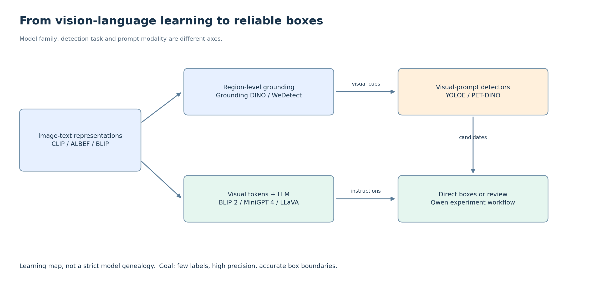

# 01 · 把技术主线连起来

**先分清三个维度：模型如何处理图文、要完成什么任务、怎样告诉它目标。** 混在一起，才会觉得模型名称越来越多。

## 1. 从“图文对应”到“接入语言模型”

| 阶段 | 代表工作 | 核心变化 | 对检测项目的意义 |
|---|---|---|---|
| 图文对齐 | CLIP | 图像与文本分别编码，在共同空间比较相似度 | 能比较“像不像某类”，本身不直接产生检测框 |
| 对齐后融合 | ALBEF | 图文对比对齐，再融合；结合匹配、掩码语言建模和动量蒸馏 | 理解相似度和跨模态交互的区别 |
| 图文理解/生成预训练 | BLIP | 兼顾编码、融合、生成；用描述生成和过滤改善数据 | 图文学习不只剩对比学习 |
| 冻结大模型，训练连接桥梁 | BLIP-2 | Q-Former 从视觉特征抽取信息并接入语言模型 | 不必从零训练完整视觉语言系统 |
| 多模态对话 | MiniGPT-4、LLaVA | 将视觉表示映射到语言模型的输入空间，配合指令数据 | 能听懂任务和关系，但框精度仍须单独评估 |
| 改进连接与指令数据 | LLaVA-1.5 | 采用更强的视觉输入与两层 MLP 连接器等 | 说明连接器和数据质量也重要，不只是 LLM 大小 |

这是**学习顺序和能力分支**，不是“后一篇继承前一篇全部结构”的严格家谱。

典型 MLLM：图像 → 视觉编码器 → 投影/连接器 → 与文本 token 一起送入 LLM → 生成回答。视觉 token 通常在语言模型输入侧参与处理；各模型的连接方式和序列组织不同，不能统称为“加在最后一层”。

## 2. 检测是另一条任务分支

| 路线 | 目标如何指定 | 模型怎样输出框 |
|---|---|---|
| 文本 OVD | 类别词、短语、指代表达 | 区域特征与文本匹配，配合检测头定位 |
| 视觉提示检测 | 参考图上的框/Mask | 编码目标外观，再去待测图找相似目标 |
| MLLM 检测 | 指令 + 图像 + 可选少量示例 | 生成坐标/结构化答案 |
| 检测器 + MLLM 审核 | 先有候选框，再给任务定义与参考图 | 检测器定位，MLLM 作候选判别或受限修正 |

VLM 是视觉语言模型的广义称呼；MLLM 强调以大语言模型处理多模态信息。OVD 是任务设置。**它们不构成三个互斥模型类别。**

文本提示与视觉提示是条件输入形式；它们也不等于“VLM 路线”和“MLLM 路线”。YOLOE、PET-DINO 都能提供文本或视觉路径；MLLM 也可以同时接收文字和示例图。

## 3. 把自己的结果放回主线

文本难描述特殊吊物 → 视觉示例能补上外观信息 → 但定位与领域差异仍限制效果 → 少样本微调或候选审核值得做消融。

这条证据链尚不能推出“所有文本 OVD 都无效”“SAVPE 没用”或“MLLM 已解决精确定位”。先看 [实验结论](04_experiment_findings.md)，再用 [统一协议](05_protocol_and_next.md) 判断瓶颈。

原理来源：[CLIP](https://arxiv.org/abs/2103.00020)、[ALBEF](https://arxiv.org/abs/2107.07651)、[BLIP](https://arxiv.org/abs/2201.12086)、[BLIP-2](https://arxiv.org/abs/2301.12597)、[MiniGPT-4](https://arxiv.org/abs/2304.10592)、[LLaVA](https://arxiv.org/abs/2304.08485)、[LLaVA-1.5](https://arxiv.org/abs/2310.03744)。

