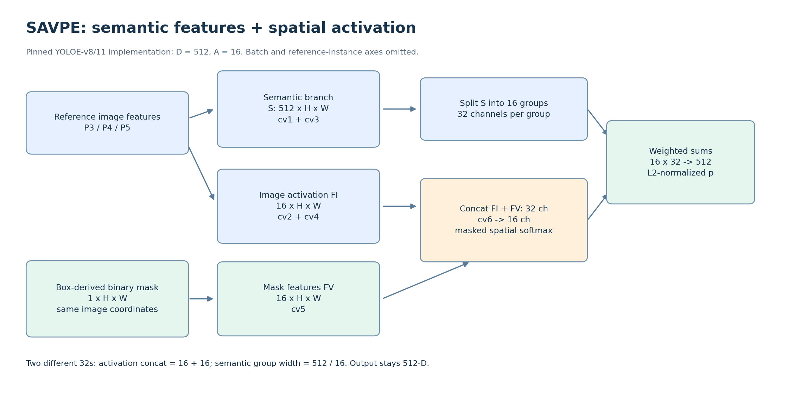
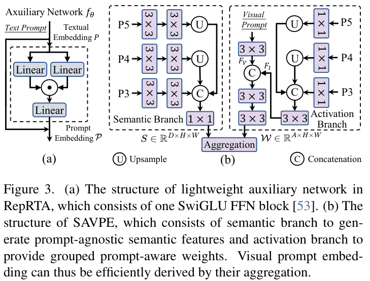

# 02 · YOLOE 与 SAVPE

YOLOE 保留 Backbone、PAN、多尺度检测头。框回归分支负责位置；Object Embedding 与 Prompt Embedding 匹配负责类别。提示向量可以理解成可更换的分类权重。

| 模块 | 输入与作用 |
|---|---|
| RepRTA | 改善文本向量与区域特征的对齐；固定词表时可重参数化 |
| SAVPE | 将参考图中指定区域编码为视觉提示向量 |
| LRPC | 先筛有物体的位置，再与内置大词表匹配，用于无外部提示模式 |

## SAVPE：外观是什么，哪些位置值得聚合

以下按官方 YOLOE-v8/11 实现，默认 `D=512, A=16`；省略 batch 维。

| 步骤 | 张量/操作 | 可学习部分 |
|---|---|---|
| 参考图提特征 | P3/P4/P5 经 Backbone、PAN 得到多尺度特征 | Backbone、PAN 参数 |
| 语义分支 | 各尺度卷积、上采样到 P3 尺度、拼接、投影；得到 `S:512×H×W` | SAVPE 内 `cv1, cv3` |
| 图像激活分支 | 多尺度特征卷积与对齐，形成 `FI:16×H×W` | `cv2, cv4` |
| 提示区域编码 | 框/Mask 转为全图二值区域，再对齐到特征坐标；`M:1×H×W` → `FV:16×H×W` | `cv5` |
| 融合 | `Concat(FI,FV):32×H×W` → `16×H×W` | `cv6` |
| 空间权重 | Mask 外设为极小值，在空间维 softmax；得到 16 组权重 | 运算本身无参数 |
| 聚合 | S 分为 16 组，每组 32 通道；各组按自己的空间权重求和 | 运算本身无参数 |
| 输出 | 16 个 32 维向量拼接并 L2 归一化 → `p:512` | 归一化无参数 |

**两个“32”要区分：** 激活图与 Mask 特征拼接时有 16+16=32 个通道；语义特征按组分配时，每组有 512/16=32 个通道。它们恰好相等，不是同一个张量，也不存在“整个表示先压成 32 维再升回 512 维”的必经步骤。

Mask 与图像特征使用**同一全图坐标系**。框内为 1，外部为 0；并非把目标裁剪后直接与全图任意位置拼接。参考图先 resize/letterbox，框与 Mask 必须同步变换。

公式：第 g 组输出为 `p_g = Σ_(x,y) W_g(x,y) S_g(:,x,y)`。每组的 32 个语义通道共享一张空间权重图。

## 512 维向量接下来去哪

待测图同样产生区域/位置 embedding `O:N×512`。与 C 类提示 `P:C×512` 匹配，得到 `N×C` 类别分数；实际实现还有归一化、可学习尺度/偏置等。位置分支独立预测框，再作后处理。

参考图与待测图可以不同。多个参考实例可先提向量再按类平均、归一化；平均策略是可控实验变量，不保证 shot 越多越好。

## 微调时最关键的区分

- **动态视觉提示**：保留 SAVPE，推理时还能更换参考目标。只训练 SAVPE 主要改变参考表示与匹配，不能直接保证框回归改善。
- **固定类别适配**：官方 PE Trainer 删除 SAVPE，将固定类别向量融合到分类头，再微调。它可以很好用，但任务协议已经不同。
- 论文的“30/2/1 epochs”是三阶段预训练配方，不是本项目少样本微调的推荐轮数。

近期“基础图像模块训练更好”只是一条待核验观察；先记录 Trainer、SAVPE 是否仍存在、实际可训练参数、参考向量是否更新，再归因。

代码定位：[SAVPE/YOLOEDetect](https://github.com/THU-MIG/yoloe/blob/40cd606cabdbe2b566d6f14a6b162c89206e9a1b/ultralytics/nn/modules/head.py)、[SAVPE 训练](https://github.com/THU-MIG/yoloe/blob/40cd606cabdbe2b566d6f14a6b162c89206e9a1b/train_vp.py)、[固定类别 Trainer](https://github.com/THU-MIG/yoloe/blob/40cd606cabdbe2b566d6f14a6b162c89206e9a1b/ultralytics/models/yolo/yoloe/train_pe.py)。

对照论文图3（原作者图片，来自已提供论文的局部）：

