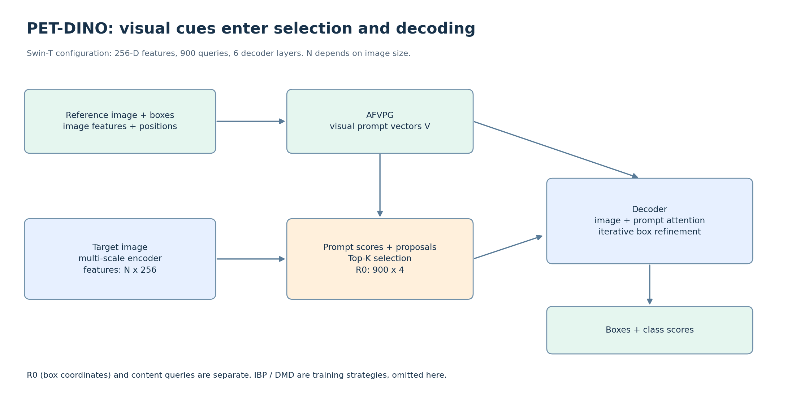

# 03 · 从区域匹配到参考框精修

## Grounding DINO：900 个初始框如何得到

多尺度图像特征展平为 N 个位置。每个位置有网格先验框，回归头预测偏移；在 logit 坐标中相加后，经 sigmoid 得到归一化框。

```python
# 教学伪代码，省略 batch、padding、训练去噪 query
memory, prior_logits = gen_encoder_output_proposals(features)
scores = class_head(memory, prompt_features)
box_logits = reg_head(memory) + prior_logits
indices = scores.max(dim=-1).values.topk(num_queries).indices
R0 = gather(box_logits, indices).sigmoid()  # [900, 4], cx, cy, w, h
```

同一组 Top-K 索引用来取框；900 是常见配置中的 query 数量，不是最终必须输出 900 个目标。Decoder 用初始参考框引导图像注意力，逐层预测框偏移。

**框坐标与 query 内容向量是两样东西。** 具体实现可用可学习 query embedding 初始化内容向量，不能一概说成“把选中位置特征直接当 query”。阈值过滤最终输出也不等于 Encoder 的 Top-K 初始化。

官方定位：[GroundingDINO transformer](https://github.com/IDEA-Research/GroundingDINO/blob/main/groundingdino/models/GroundingDINO/transformer.py)。

## PET-DINO：把视觉提示接入 DINO 检测过程



参考图特征 + 参考框的位置编码/内容查询 → AFVPG 产生视觉提示向量 → 支持类别匹配与 query 选择，并在 Decoder 中参与交互 → 输出类别和逐层精修框。

官方 Swin-T 配置使用 256 维特征、3 层视觉提示生成模块、900 个检测 queries、6 层 Decoder；这些是该配置数值，不是所有模型的定律。多尺度空间位置数 N 受 resize、padding 和实际输入尺寸影响，不能始终写成 8500。

| 比较点 | YOLOE | PET-DINO |
|---|---|---|
| 检测骨架 | YOLO 多尺度稠密预测 | Grounding DINO / Transformer |
| 视觉提示编码 | SAVPE 卷积 + 分组加权聚合 | AFVPG 等注意力处理 |
| 提示参与位置 | 主要形成分类匹配向量 | 参与 query 选择、Decoder 交互和匹配 |
| 定位 | 回归分支预测 | 基于参考框逐层精修 |
| 常见 embedding | 512 | 256（所查 Swin-T 配置） |
| 本项目观察 | 吊物视觉提示较好，shot 收益渐小 | 现有设置效果弱，仍需检查参考与阈值 |

IBP 是 Intra-Batch Parallel Prompting，DMD 是 Dynamic Memory-Driven Prompting；两者属于提示丰富训练策略。不要把 IBP 直接解释为“一个实例记忆库”，也不要把训练记忆库更新画成每次用户推理都必需执行的步骤。

来源：[PET-DINO 项目](https://github.com/fuweifuvtoo/PET_DINO)、[检测实现](https://github.com/fuweifuvtoo/PET_DINO/blob/7830a462f9a320f34293cce0aabdda1256d9dc15/mmdet/models/detectors/pet_dino.py)、[Swin-T 配置](https://github.com/fuweifuvtoo/PET_DINO/blob/7830a462f9a320f34293cce0aabdda1256d9dc15/configs/pet_dino/pet_dino_swin-t_8xb4_12e_obj365.py)。

## WeDetect：三个角色，不是同一任务的三个尺寸

| 模型 | 训练/适配重点 | 推理输入 → 输出 |
|---|---|---|
| WeDetect | 图像区域与文本的共同检索空间 | 图像 + 类别文本 → 类别/框 |
| WeDetect-Uni | 冻结检测器，学习 objectness prompt | 图像 → 通用候选框及其 embedding |
| WeDetect-Ref | LMM 对候选目标作表达条件下的选择 | 指代表达 + 候选 → 被指代目标 |

Ref 从候选中选目标，不能把候选漏掉的物体凭空补回来；它也不是默认替候选框做回归。WeDetect 官方要求中文类别词，具体历史提示是否符合需核对原 prompt 快照。

论文表中的 AP 要结合具体 benchmark：检测 AP、LVIS Fixed AP、REC 的准确率等并非同一口径。**不带下标的 AP 通常不能直接当 AP50。**

来源：[WeDetect 官方说明](https://github.com/WeChatCV/WeDetect)。

